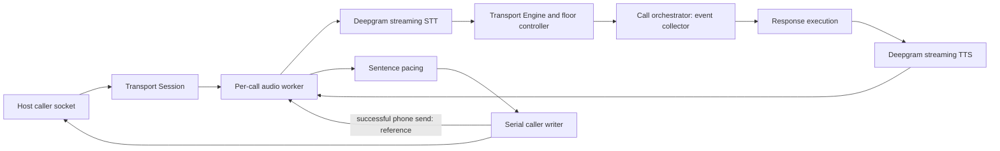

# Vogon Rust: implementation guide

This workspace contains audio processing, deterministic control modules and
streaming adapters, a concurrent call orchestrator and the runnable module-10
HTTP/WebSocket gateway host. [MODULES.md](MODULES.md) records implemented behavior and
remaining integration. The Python gateway is the compatibility reference.

## Where to start

| Question | Read |
|---|---|
| Who coordinates parallel calls and speculative EOT? | [illustrated call flow](crates/orchestration/CALL_FLOW.md), [orchestration](crates/orchestration/README.md), [performance and clock isolation](crates/orchestration/PERFORMANCE.md) |
| How does the host connect a caller? | [service host and session lifecycle](crates/service/README.md), [transport Session](crates/transport/src/session.rs) and [adapter guide](crates/transport/README.md) |
| How are transcript callbacks turned into call events? | [transport Engine](crates/transport/src/engine.rs) |
| How is speech streamed and interrupted? | [response execution](crates/transport/src/session/playback.rs), [provider actors](crates/speech-providers/src/client.rs), [serial writer](crates/transport/src/wire.rs) |
| Who owns AEC, VAD and resampling state? | [audio runtime](crates/audio-runtime/src/lib.rs) and [native library boundary](crates/audio-core/NATIVE_LIBRARIES.md) |
| Why does a barge-in continue, wait or cut? | [floor controller](crates/barge-in/src/floor.rs), [gate](crates/barge-in/src/gate.rs), [semantic rules](crates/barge-in/src/semantics.rs) |
| What was sent versus heard? | [playback state](crates/playback/src/state.rs), [ledger](crates/playback/src/ledger.rs), [delivery report](crates/playback/src/delivery.rs) |
| Who selects waiting speech or detects a machine line? | [front module](crates/front/README.md), [source](crates/front/src/source.rs), [holds](crates/front/src/hold.rs), [line detector](crates/front/src/line.rs) |
| Where are timeouts and silence decisions? | [call clocks](crates/clocks/src/call.rs), provider actors and the transport heartbeat |
| How are settings and wire types maintained? | [configuration](crates/configuration/README.md), [contracts](crates/contracts/README.md), [generator](tools/generate_contracts.py) |
| Which behaviors have evidence? | [transport/provider validation](validation/transport/README.md), [module validation](validation/modules/README.md), [audio validation](validation/audio/README.md) |

## Data flow

For startup and shutdown entry/exit points, the per-call Tokio task graph,
eager/final execution and clock interfaces, use the
[detailed call-flow diagrams](crates/orchestration/CALL_FLOW.md). They distinguish
implemented Rust components and application speculation. Transfer/artifact hooks
are now installed by the service; [operations](OPERATIONS.md) documents retries,
readiness, metrics and deployment limits.

The diagram shows the phone path. Browser input forwards configured raw PCM to
STT and output uses browser framing; it does not run the phone AEC/floor path.
Text mode requires no speech credentials or provider connections.

The host polls the caller socket independently while the driver collects events
and executes response work in separate tasks.
Awaiting an entire response before reading caller input would prevent normal
interruption. `Session::send_response` allows one active response; a second
concurrent request returns `playback_busy`. Provider sockets read independently
of paced output so a slow consumer does not prevent Ping/Pong handling.

## Ownership and lifetime

| Owner | Responsibility | Completion and cleanup |
|---|---|---|
| `Service` / `Lease` | Process admission, shutdown broadcast, session store and unique socket ownership | Stop admission, signal each driver, await finalization, release claims/permits. |
| `Driver` | Per-call input task, event collector, ordered API/response worker and front hold | Join tasks, close/drain transport, await terminal API and artifact hook; no mutable cross-call counters. |
| `Session` | Per-call adapter, callback/timer tasks, provider owners and writer task | Stop/join host response tasks, then explicitly call `close`; keep consuming final callback events. |
| `Engine` | Transcript annotations, sequence numbers, floor effects, playout state and clocks | State transitions are serialized under the session lock; socket I/O occurs outside it. |
| `AudioRuntime` | Dedicated worker owning native handles, NumPy/audioop, frame buffers and mixer | `close` drains accepted commands and joins the worker; do not hold the GIL while waiting. |
| `Audio` | Async access to the shared worker | Construction, response waits and explicit close use blocking executor capacity. |
| `SttClient` / `TtsClient` | Independent protocol actors and connection state | Explicit close requests protocol shutdown; Drop aborts rather than guaranteeing a drain. |
| `Writer` / `WriterTask` | Ordered caller sends and post-send AEC/mark receipts | Task lifetime belongs to the session; a send failure terminates its loop. |
| `Source` / `Hold` | Per-call generation/ledger and filler delivery work | Cancel source on resumed/superseding speech; end hold before desk output; Drop aborts owned tasks. Module 9 supplies lifecycle triggers. |
| `line::Detector` | First-turn instrument state and verdict/quiet policy | Session dispatches tokenized requests, ticks windows and closes the detector on shutdown. |
| `CallClocks` | Deterministic timer state | The transport supplies ticks; this object neither sleeps nor spawns tasks. |

Audio workers release the interpreter while waiting for commands. NumPy and
audioop still require CPython and its GIL; one worker per call does not establish
unlimited throughput. Provider network tasks do not use Python SDKs. SpeexDSP
and WebRTC VAD own direct C handles. Mixing and synthetic ambience generation use
native Rust arithmetic; WAV loading retains Python wave/audioop behavior.

## Three meanings of completion

1. **Provider completion:** TTS `Finished` means every segment received Flushed.
   A closed receiver or failed socket is not successful completion.
2. **Send completion:** the caller `Sink` accepted a frame. Only then does the
   writer register its mark or enqueue its exact audio bytes as an AEC reference.
3. **Playback receipt:** a phone mark returns from the caller transport. Playback
   accounting and the heard horizon advance from these receipts and estimates.

A delivery report can therefore complete while phone audio is still draining.
Neither provider completion nor socket-send acknowledgement proves audibility.
Browser reports retain unknown audio duration. Never implement `Sink::send` as
an acknowledgement of a separate unobserved queue, and do not synchronously
re-enter the same session from that method.

## Cancellation, clear and retry

Caller clear invalidates older queued media/mark generations immediately. An
already running send finishes first, including its AEC reference update. The
writer then sends clear and applies native clear/playback accounting. Failed
sends do not register references or marks. `ResetOutput` only resets framing and
resampling; `Clear` also discards queued AEC references. Starting a new utterance
must not erase references for older audio still buffered at the caller.

TTS cancellation separately sends provider Clear and drains old audio until
Cleared. A 300 ms drain timeout closes that connection; another utterance must
reconnect. This deliberately tightens Python's dirty-socket reuse behavior.
Incoming provider audio remains unbounded to preserve existing receive behavior;
production memory/admission limits remain work to complete.

Phone synthesis failure permits one reconnect/retry, using the unsent sentence
suffix and existing apology. Audio already sent remains buffered. Watchdog
duration includes both attempts. Caller cancellation interrupts a stalled
provider or pacing wait, and dropping a response future schedules cleanup.
Explicit call shutdown is still required to await cleanup deterministically.

## Eager EOT and floor decisions

Flux eager EOT is speculative. TurnResumed preserves text for stitching and
notifies consumers that speech continued. Definitive EOT produces final text and
updates word-confidence statistics. The legacy hold has its own timer: an
ordinary Update does not cancel it, while a nonempty StartOfTurn does. Remote
close and explicit shutdown have distinct fallback/drain semantics.

The phone adapter forwards accepted audio to STT before applying floor effects.
During playback, drain or echo cooldown, the worker applies the retained AEC and
gate policy. With AEC disabled, overlapping input is suppressed. The current
phone gate's opaque mu-law-to-VAD callback convention is preserved; changing it
is a separate DSP decision, not a documentation correction.

The floor controller requests remote classification with a dispatch token.
With `Config.judge` installed, Session executes the module-8 native Cerebras
client and returns completion/error with that token. Otherwise the host receives
`classifier_request` and must use `classifier_result`. A deadline does not release
the physical slot until completion arrives. Stale results cannot cut newer audio.

An enabled phone line detector uses `Config.line_client` (Jev). It binds the first
qualifying STT turn and issues at most one verdict. Machine breakthrough cuts
protected playback before publishing the verdict and optional replayed final;
the final receives the updated generation. `wait_line_quiet` and
`release_line_hold` expose the machine-greeting wait to the orchestrator.

Module 8 also owns safe front selection and source/canned holds. The Session
implements its `Speaker` interface. Module 9 coordinates generation, resumed
speech, reasoning pauses, hold closure and ordered Turn API commits while input
continues. Eager speculation itself runs on the application server; gateway
side effects wait for a final response and current revision authorization.

## Units and formats

| Boundary | Unit or format |
|---|---|
| Host clock, onset, deadlines, `at` | Monotonic seconds from the same per-call `Clock`; provider-relative word times require projection. Explicit contract UTC fields are separate. |
| `*_ms`, delivery audio duration, pacing lead | Milliseconds; do not mix them with monotonic seconds. |
| Default phone input/output | Mono 8 kHz mu-law; full frames contain 160 bytes / 20 ms. |
| Internal mixer PCM | Little-endian signed PCM16; 160 samples contain 320 bytes. |
| Default browser STT / TTS | Raw linear16 input configured at 16 kHz; output configured at 24 kHz. The host must supply the agreed input format. |
| Browser output packet | Little-endian u32 UTF-8 ID byte length, ID bytes, then PCM; 8192-byte merge threshold emits the entire accumulation. |
| Gains and RMS | Gains are linear multipliers; RMS uses retained audioop sample arithmetic. |

The audio core can convert legacy 24 kHz linear16 phone chunks, but the current
session adapter accepts only the default mu-law sentence path. Unsupported
gated-feed, burst and disabled-controller configurations are rejected rather
than silently using different playback policy.

## Configuration, credentials and generated types

Use `settings` to resolve explicit values over environment, dotenv and defaults.
Resolve tenant/call policy with `resolve_call_snapshot`, then pass that snapshot
to `Config::from_snapshot`. Speech settings use the validated settings and
explicit per-call overrides. `SpeechSettings::load(path)` can read an existing
dotenv file without copying it or changing process environment.

`ApiKey` redacts Debug output and is not serializable. The general generated
settings models contain plain credential strings and must not be logged wholesale.
Provider error codes must be trusted categories; `Error::new` does not sanitize
arbitrary text. Transcript-bearing events and snapshots can contain caller data.

Generated contract/configuration structs describe data, including modules not
yet implemented. They are not evidence that a transfer or recorder exists. Keep role documentation in `tools/generate_contracts.py`; regenerate
types instead of editing generated declarations by hand.

## Compatibility and acceptance limits

The parity runners execute actual Python implementations as oracles and compare
outputs, callbacks and relevant state. Native lifecycle tests cover behavior
without a direct Python equivalent. Source and binary hashes identify the tested
revision; a later documentation edit changes source hashes, so saved reports
remain evidence for their recorded revision rather than being silently relabeled.

Intentional differences include standard Rust Unicode whitespace, post-send
accounting, immediate stalled-provider cancellation and TTS timeout reconnection.
Known AEC cold-start failures and changing-path leakage remain. Offline parity
does not establish live-call quality or concurrency capacity. GPT Live testing
is paused and excluded from default validation. See the module checklist for
durable fact acknowledgement and deployment acceptance still pending. Transfers
and recording are implemented with local protocol tests and Python parity.
Service-specific compatibility and recovery limits are documented in the
[module-10 guide](crates/service/README.md).
