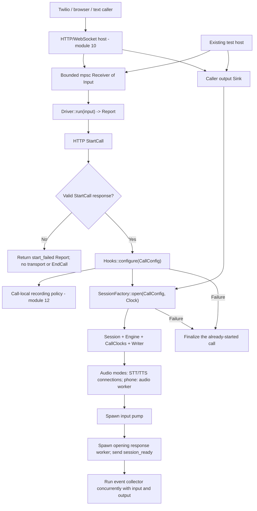
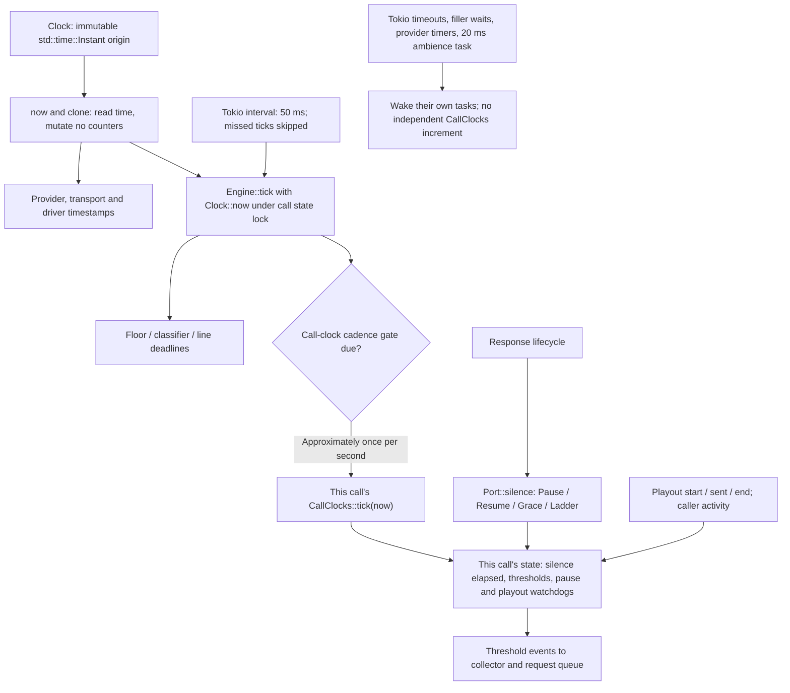
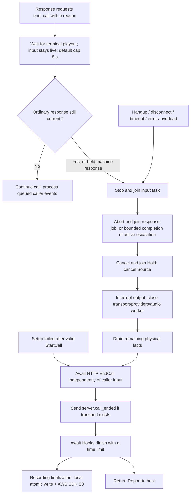

# Current call flow, eager execution and clock ownership

This guide describes the implemented call path. Rust/Tokio owns transport and
call coordination. The existing Python Turn service owns application reasoning
and speculative model work. The [module-10 HTTP/WebSocket host](../service/README.md)
now supplies bounded caller input and the actual socket `Sink`; driver-level
tests can also inject these interfaces directly.

Boxes describe existing code or an existing external service. Diagrams show
logical tasks and interfaces, not one operating-system thread per box.

## Entry points and startup



`Driver` receives an already-constructed `TurnApi`, `Factory`, `Hooks`, `Clock`
and call configuration. `SessionFactory` consumes one caller `Sink`; create a
factory and HTTP Turn client per call. Text mode opens no speech-provider sockets.
The input pump starts before opening speech, so the caller can send input during
the introduction. Opening speech finishes before the next queued API trigger is
dispatched, although collection and invalidation already run concurrently.

| Boundary | Existing interface | Purpose |
|---|---|---|
| Call entry | `Driver::run(mpsc::Receiver<Input>) -> Report` | Own the call until explicit finalization completes. |
| Caller input | `Input::Json`, `Input::Binary`, `Input::Disconnect` | Carry protocol controls/media or request disconnect; closing the channel also terminates intake. |
| Transport construction | `Factory::open(...) -> Opened` | Return a `Port`, transport event receiver and optional front `Source`. |
| Caller output | `Sink::send(Frame)` through the serial `Writer` | Send media, marks, clear and client control frames. Send acceptance is not a playback receipt. |
| Application boundary | `TurnApi::{start, process, end}` | Native HTTP client for StartCall, ProcessEvents and EndCall. |
| Integration hooks | `Hooks::{configure, prepare_escalation, escalate, finish}` | Host saves the snapshot and recording policy, prepares native transfer state before handoff speech, executes transfer after playout, and finalizes recording/artifacts. `NoHooks` remains a test/embedding option. |
| Call exit | Returned `Report` | Report reason, errors, terminal acknowledgement and call-local counters to the host. |

Source: [driver](src/driver.rs), [ports and factory](src/port.rs),
[HTTP client](src/client.rs), [transport Session](../transport/src/session.rs).

## Tokio tasks and full-duplex flow

```mermaid
flowchart LR
    Input["Caller input channel"] --> Pump["Input pump: tokio::spawn"]
    Pump --> Session["Session input / controls"]
    Session --> Audio["Phone audio worker: AEC and VAD"]
    Audio --> STT["Streaming STT actor"]
    Session -->|Browser PCM| STT
    Session -->|Text message| Engine["Engine / floor / playback state"]
    STT --> Callbacks["STT callback task"]
    Callbacks --> Engine
    Timers["Transport timer tasks"] --> Engine
    Engine --> Events["Transport event channel"]

    subgraph DriverTask["Driver::run future"]
        Collector["Collector: tokio::select! biased"]
        Inbox["Inbox: deduplicate and queue triggers"]
        State["Call-local facts and revision"]
        Collector --> Inbox
        Collector --> State
    end

    Events --> Collector
    Pump -->|Completion / error| Collector
    Inbox -->|When no response job is active| Worker["API / response worker: tokio::spawn"]
    Worker -->|Completion / end reason| Collector
    Worker -->|Permission request: mpsc + oneshot| Collector
    Collector -->|Current revision authorized?| Worker
    State -->|watch notification on revision change| Worker
    Collector -->|Prime or cancel| Source["Optional front Source"]
    Worker --> HTTP["ProcessEvents await"]
    HTTP <--> Turn["Python Turn service"]
    Worker --> Hold["Optional Hold task: tokio::spawn"]
    Source --> Hold
    Hold -->|Authorized filler| Speak["Session speech admission"]
    Worker -->|Authorized response| Speak
    Speak --> TTS["Streaming TTS actor"]
    TTS --> Output["Phone mixer / pacing or browser framing"]
    Output --> Writer["Serial Writer"]
    Writer --> Sink["Caller Sink"]
    Writer -->|Successful phone send: AEC reference| Audio
    Sink -.->|Caller mark arrives through input| Input
```



The collector is the `Driver::run` future itself. The input pump, opening/response
jobs, hold and transport/provider tasks are separately spawned. The host polls
each driver on a Tokio multithread runtime; tasks can execute on different
workers and are not pinned to dedicated threads. The native phone audio runtime
has its own serialized worker; blocking audio work stays off Tokio workers.

The collector selects input-task completion, transport events, output permission
requests and response-task completion. Already-queued transport events take
priority over permission requests. Before ordinary output, the response worker
asks the collector to authorize its speech revision and also checks the floor's
playback generation. This lets a queued changed final invalidate a response even
when its worker is running on another core. Callback replay is deduplicated;
later utterances with the same words are still legitimate new turns.

Input, STT callbacks, event collection and timers continue during HTTP waits,
retry delays, filler speech and TTS. A **single API/response worker** serves each
call: the next request waits until current response execution finishes or is
interrupted. Speech commands are sequential. A normal hold ends by letting its
current filler finish before desk speech; shutdown aborts and joins it.

The multi-call ownership boundary is:

```text
Host Tokio multithread runtime
  |
  +-- Call A: Driver + Inbox + counters + CallClocks + providers + writer
  +-- Call B: Driver + Inbox + counters + CallClocks + providers + writer
  +-- Call C: Driver + Inbox + counters + CallClocks + providers + writer

No mutable call counters or call-ordering locks cross these boundaries.
Tasks within one call coordinate through that call's channels and short locks.
```

## Eager execution and final commitment

The sequence below applies when the application permits speculation. The Rust
task sends and awaits the HTTP request; the speculative application task is
created by **Python `asyncio.create_task`**, not by Tokio. Front-source priming is
separate from this application speculation and does not commit a caller turn.

```mermaid
sequenceDiagram
    participant STT as Caller / STT
    participant C as Rust collector
    participant W as Rust response task
    participant API as Python Turn API
    participant Spec as Python speculative task
    participant TTS as Rust TTS / caller output

    STT->>C: EagerEndOfTurn: pay
    C->>C: Accept trigger; set revision R; prime front Source
    C->>W: Dispatch eager when worker is available
    W->>API: ProcessEvents: facts + eager, stable request ID
    API->>API: Capture pre-speculation checkpoint
    API->>Spec: asyncio.create_task: compute with deliver=False
    API->>API: Retain/pin context across requests
    API-->>W: Empty acknowledgement
    W->>W: Never execute eager response side effects
    Note over STT,Spec: Input and event collection continue while speculative compute runs

    alt Matching final
        STT->>C: Final: pay
        C->>C: Retain revision R; deduplicate callback replay
        C->>W: Dispatch one final request
        W->>API: ProcessEvents: facts + final
        API->>Spec: Reuse / await matching valid speculation
        Spec-->>API: Result
        API-->>W: Committed final response
    else Changed final
        STT->>C: Final: pay tomorrow
        C->>C: Advance revision; invalidate old gateway output now
        C->>W: Dispatch changed final in request order
        W->>API: ProcessEvents: facts + changed final
        API->>Spec: Discard / cancel old speculative work
        API->>API: Process authoritative final
        API-->>W: Committed final response
    else TurnResumed
        STT->>C: Caller resumed speaking
        C->>C: Advance revision; invalidate output; cancel front Source
        C->>W: Dispatch resumed event in request order
        W->>API: ProcessEvents: facts + resumed
        API->>Spec: Cancel speculation
        API-->>W: No committed speech
    end

    opt Final response contains ordinary speech
        W->>C: Authorize response revision
        C-->>W: Permission after processing already-queued events
        alt Revision and floor generation are current
            W->>TTS: Deliver speech with generation checks
        else Response is stale
            W->>W: Suppress stale speech and terminal actions
        end
    end
```

The server can fall back to normal final processing if a matching speculative
result is unavailable or invalid. An eager acknowledgement alone is not evidence
that speculation ran. In the current application, engine-hosted calls skip the
eager speculative path; non-retainable request contexts and enforced STT quality
gates can also suppress eager work.

**A final can arrive before the eager HTTP acknowledgement.** The collector
accepts it and updates the revision immediately, but its request stays queued
until the active worker finishes. The eager response still cannot speak,
escalate, send client events or end the call. Superseded eager triggers that have
not yet been sent are skipped. Once a transaction is in flight, a revision change
does not cancel that HTTP transaction solely to make room for another request.

One committing HTTP transaction per call preserves the current server contract.
Retries reuse the request ID/body and compose with server response caching. Safe
overlapping mutations would require a versioned server protocol and acknowledged
cancellation. Gateway stale-output suppression cannot undo already committed
application state or tool effects. Physical interruption of active speech uses
the transport/floor cancellation path; revision invalidation alone is not an
audio clear operation.

Held `play_after="line_quiet"` machine speech is the explicit exception to ordinary
revision/floor admission: it waits for the greeting, takes the floor and uses
protected/absorb policy. See [response rules and limitations](README.md#response-and-cleanup-rules).

Sources: [Rust inbox](src/state.rs), [Rust response worker](src/driver.rs),
[application event handling](../../../data-plane/app/turns/api.py),
[speculative executor](../../../data-plane/app/turns/executor.py),
[HTTP context retention and request cache](../../../data-plane/app/turns/http_service.py).

## Clock interface and isolation



| Interface | State and effect |
|---|---|
| `Clock::now(&self) -> f64` | Read-only monotonic seconds since an immutable origin. Clones share a coordinate, not mutable accounting. |
| `Engine::tick(now)` | Drive floor/line work and gate `CallClocks` progression to approximately one-second cadence. Multiple producers cannot independently charge that interval. |
| `CallClocks::tick(&mut self, now)` | Apply elapsed time to this call's accounting and emit due thresholds. Repeated timestamps do not double-count elapsed time; backwards ticks are ignored. |
| `Port::silence(Silence::Pause / Resume)` | Adjust this call's nested reasoning-pause depth. Duration thresholds and watchdogs still run. |
| `Port::silence(Silence::Grace / Ladder)` | Apply the application's returned silence policy to this call. |
| Playback and caller activity methods | Update this call's playback depth, silence window and watchdog anchors. |

Each `Engine::new` allocates its own `CallClocks`. Each driver allocates its own
revision, request/wire counters, fact spool and hold; `Shared` means shared among
that call's tasks only. Each writer has its own output epoch. Immutable schema
and guard constants may be shared globally; mutable call state is not.

Tokio schedules wakeups, while `Clock` reads `std::time::Instant`. Pausing Tokio's
test time does not advance or freeze that `Clock`; deterministic accounting tests
pass explicit timestamps into `CallClocks`/`Engine`. Wire envelope `ts` uses wall
time separately. Call duration subtracts the driver's own start timestamp.

Timer and receipt events do not notify the speech-revision watcher unless the
revision actually changes. They therefore cannot end a reasoning hold merely by
arriving. A duration threshold is still an ordered application trigger: collection
continues during a slow request, but threshold processing is not a second
concurrent same-call HTTP transaction.

Sources: [Clock](../clocks/src/lib.rs), [CallClocks](../clocks/src/call.rs),
[Engine cadence](../transport/src/engine.rs), [Session timer tasks](../transport/src/session.rs).

## Timers, deadlines and timelines

Values below are **code/schema defaults**, not measured latency or a dump of a
running call's configuration. Settings and returned `CallConfig` can override
them. Each timer belongs to a call, connection or operation. Most start only when
that operation starts; they are not all armed at call entry. Diagrams are not to
scale. Scheduled times are eligibility times, not hard real-time guarantees.

### Where timers execute and where their events go

The host owns the Tokio runtime. Each call owns its Session, Engine, CallClocks,
provider connections and timer registrations; it does not create a runtime or a
timer thread. Tokio's timer machinery wakes eligible async tasks, which execute
on runtime workers. A sleeping task does not occupy a worker thread. `Clock::now`
only reads monotonic time; it neither schedules work nor increments counters.

| Call mode | Recurring timer sources after successful setup |
|---|---|
| Text | 1: Session heartbeat |
| Browser audio | 3: heartbeat and one keepalive interval in each STT/TTS socket task |
| Phone without ambience | 3: heartbeat and STT/TTS keepalive intervals |
| Phone with ambience | 4: adds the ambience task |

These are counts of recurring intervals, not all tasks or all registered timers.
HTTP deadlines, cancellation windows, filler waits and pacing add temporary
sleep/timeout futures inside their owning operations. The one-second accounting
gate and the floor deadlines are state checks inside the heartbeat; they do not
each spawn another timer task. The optional Live listener replaces the STT socket
in this count; it does not add a second listener.

```text
Host Tokio runtime: timer machinery + worker pool
  |
  +-- Call A
  |    +-- Session heartbeat task: 50 ms
  |    |     +-- lock Call A's Engine; tick(Clock::now())
  |    |     |     +-- floor / classifier / pending final / line checks
  |    |     |     +-- if accounting gate due: CallClocks::tick(now)
  |    |     +-- release state lock; await dispatch of effects/events
  |    +-- optional ambience task: 20 ms --> mixer --> output writer
  |    +-- STT socket task: 20 s keepalive --> provider socket
  |    +-- TTS socket task: 20 s keepalive --> provider socket
  |    +-- temporary operation waits: HTTP / hold / cancellation / pacing
  |
  +-- Call B: separate instances of the same state and tasks

Engine transition or reached threshold
  |
  v
Session::dispatch()
  +-- local effect: interrupt / Clear / gate reset / classifier dispatch
  +-- event --> this call's mpsc channel --> Driver collector
                                             +-- validate / deduplicate
                                             +-- fact: save for next request
                                             +-- trigger: enqueue in Inbox
                                                          |
                                                   API worker available
                                                          |
                                                   Turn ProcessEvents
```

A heartbeat does not emit a generic application event on every tick. A reached
threshold or state transition may produce an event or local effect. Silence and
duration thresholds become ordered application triggers. A playout watchdog can
update accounting without creating such a trigger. Provider timers act within
their actors/socket task; HTTP timeouts return errors to the awaiting worker.
These paths do not share one universal timer-event queue.

`dispatch()` preserves effect ordering and awaits some output/cancellation work.
It does not hold the Engine state lock during that I/O, but the heartbeat awaits
dispatch before its next iteration. Slow dispatch can delay this call's future
checks. The state's due-time check is therefore not a hard execution-time bound.
See the [state transitions and firing conditions](TIMER_VALIDATION.md#state-changes-that-arm-and-fire-timers)
and [validation limitations](TIMER_VALIDATION.md#what-this-establishes-and-what-remains-limited).

### Recurring work

| Work | Cadence and owner | What fires |
|---|---|---|
| Engine heartbeat | Session Tokio interval, 50 ms; first tick immediate, missed ticks skipped | Floor/classifier/final-wait and line-detection checks; call-clock cadence gate. |
| Call accounting | Engine gate, approximately 1 s | `CallClocks::tick(now)`: duration/silence thresholds and pause/playout watchdogs. Applies elapsed time, not one counter increment per timer callback. |
| Phone ambience | Optional Session Tokio interval, 20 ms; first tick immediate, missed ticks skipped | Mix/send ambience and check whether typing sound is due. Enabled for Twilio ambience only. |
| Provider keepalive | Each provider socket, first Ping at 20 s, then every 20 s | A Pong must clear the pending Ping before the next tick, or the socket fails. This interval retains Tokio's default missed-tick behavior, unlike the Session intervals. |
| Conditional wait polling | 50 ms while waiting | Check terminal playout receipts, machine-line quiet, or optional floor admission. These loops stop when the particular wait completes. |

```text
Relative to each Session timer's creation:
time (ms)       0     20     40     50     60     80    100   ...  1000
ambience       *------*------*-------------*------*------*---...    *
heartbeat      *--------------------*-------------------*---...    *
CallClocks     initialized; first accounting tick when Engine's +1 s gate is due

Relative to EACH provider socket's keepalive interval:
time (s)       0 ------------------ 20 ------------------ 40
keepalive      connected            Ping                 next tick:
                                    |                    Ping if Pong received;
                                    +-- awaiting Pong --> fail if still pending
```

The ambience, heartbeat and provider clocks are independent wakeup schedules.
Only the Engine's accounting gate advances `CallClocks`; another call or a
keepalive/ambience tick cannot charge this call's silence or duration counters.

### Conversation deadlines

| Deadline/window | Arm point and default | Expiry/reset behavior |
|---|---|---|
| Provider EOT timeout | Deepgram connection setting: 1000 ms generally, 1400 ms for phone in the gateway schema | Sent to the provider; not a Rust sleep. Eager EOT uses confidence thresholds and provider events, not a fixed local eager timer. |
| Legacy final hold | Non-eager STT receives `EndOfTurn`: 250 ms | Emit held final once. `TurnResumed` or a nonempty `StartOfTurn` cancels it; an update alone does not. Native eager mode emits the final immediately, without this hold. |
| Semantic classifier | Classifier dispatch +700 ms | Heartbeat applies timeout. Physical worker remains draining until completion; late results cannot regain authority. |
| Final waiting for classifier | Final wait creation +700 ms | Poll on heartbeat/completion; expiry advances the episode revision and rejects late cuts. This is separate from the classifier's dispatch deadline. |
| Unresolved barge decision | Episode onset +900 ms | Heartbeat marks unresolved text as a failed attempt; policy/protection still governs any cut. |
| Caller floor release | Final seen AND at least 500 ms since last caller speech | Heartbeat releases caller floor; new speech moves the silence anchor. |
| Front filler selection | `Source::hold_line` start: pending-model fallback at 900 ms; empty-result fallback at 1500 ms | A usable ready line can return earlier. Reasoned silence can suppress filler. End/supersession cancels waiting. |
| Front follow-up filler | First filler speech completes +2500 ms | One further source line, if hold is still active and admission permits it. Source minimum gap is separately 6 s; it can suppress the line. |
| Canned filler | Hold start +`first_after_ms`; each completed filler +`interval_ms` | Values and maximum count come from the application's `FillerPolicy`; no universal Rust duration default. |
| Typing sound | Engine publishes a turn and arms `typing_delay_ms` (default 0 ms) | Optional phone ambience loop starts it when due; response/floor cleanup clears it. Zero delay still waits for that loop to observe it. |
| Line detector retirement | First opening speech completion/clear +2 s | Heartbeat retires the detector; a bound unfinished turn can extend to +22 s. An in-flight classifier postpones retirement while it completes. |
| Machine-line quiet | Final seen AND 700 ms since the later of last transcript/final | Quiet wait releases; explicit release wins. Separate cap is 8 s from verdict, not from wait entry. |

```text
EAGER PATH (event spacing is illustrative; no fixed eager-to-final delay)

caller/STT    speech --> EAGER ------ more words? ------ FINAL / RESUMED
collector                | keeps receiving events --------| updates revision
Rust API worker          |-- eager HTTP --ack             |-- final HTTP -->
Python Turn service         |====== speculative compute ======|
                                                  match: reuse
                                                  change/resume: discard

If FINAL arrives before the eager HTTP acknowledgement:
  collector handles it now; final HTTP waits for the same-call worker.
  Each dispatched HTTP attempt has its own 40 s default limit.

FRONT HOLD (separate anchor H = hold_line invocation; only if enabled)
H + 0 ms       wait for source; ready valid text may return immediately
H + 900 ms     pending-model fallback becomes eligible
H + 1500 ms    empty-result fallback becomes eligible (alternative branch)
F              first filler speech completes, if a line was admitted
F + 2500 ms    follow-up eligible, subject to minimum-gap/admission checks
answer ready   stop waits/repeats; let in-flight filler finish before reply

BARGE-IN (separate anchors; deadlines can overlap)
B              caller speech episode begins
D              semantic classifier dispatched --> D + 700 ms timeout check
B + 900 ms     unresolved-decision check, if still applicable
E              final received while classifier pending
E + 700 ms     final-wait expiry, if still pending; reject late result
S + 500 ms     floor release eligible after last speech S, only with final seen
C              TTS Clear sent --> Cleared ack OR C + 300 ms: fail socket closed
```

The 700/900/500 ms floor deadlines are evaluated on the 50 ms heartbeat (or
relevant completion), so they can be observed on a later tick. The 300 ms TTS
cancel deadline is an actor timer, armed after sending `Clear`; it discards late
audio and forces reconnection if acknowledgement never arrives. Neither timeout
changes which transcript is authoritative. Revision/generation checks still
guard output, even if a task completes at the same time as a deadline.

### Call accounting, I/O and recovery limits

| Timer/limit | Anchor and default | Effect |
|---|---|---|
| Duration thresholds | Call-clock start + each `duration_thresholds.after_sec` | Emit each named rung once. Ordered application triggers; not an independent hard call-kill timer. |
| Silence thresholds | Accumulated eligible idle time reaches opening/default ladder rungs | Only accrue when armed, not playing and not paused; caller activity resets the window. Grace replaces the rung with the granted duration, with `exit` 15 s later. Rungs come from `CallConfig`. |
| Reasoning-pause watchdog | First accounting tick observing a pause +30 s | Clear stuck silence-pause depth; duration accounting continues while paused. |
| Playout watchdog | First accounting tick observing playout + known audio duration +10 s; otherwise +90 s | Release stuck playout accounting. Overlapping playout preserves the later outstanding deadline. This is not a heard receipt or a TTS request timeout. |
| Caller receive idle | Each input-pump receive wait: 600 s fallback | Positive maximum configured duration threshold replaces the fallback. Receiving input restarts the wait; this is not elapsed call duration. |
| Turn HTTP attempt | Dispatch +40 s | Request and outer attempt timeout use the same budget, not additive budgets. Retry transport/5xx failures after 0.25, 1, 2, 4, 8 s, up to six attempts; EndCall uses at most two. |
| Front/semantic HTTP | Per request: front 900 ms, semantic judge 700 ms, Jev 4000 ms | Front HTTP wrapper additionally caps processing at request budget +500 ms. Jev retry delays are 125, 250, 500, 1000 ms (up to five attempts); logical floor expiry may precede physical request completion. |
| Provider connect/send | Connect 15 s; socket send/flush 5 s | Fail the affected socket operation. Writer queue admission is separate from the underlying send timeout. |
| Caller output send | Underlying `Sink::send` 5 s | Fail stalled output; queue residence is not covered by that send budget. |
| TTS cancellation | Successful Clear send +300 ms | Accept `Cleared`, or close the socket to prevent old audio entering new speech. |
| TTS retry | Retryable start/synthesis failure +200 ms | Delay before retry; synthesis retry sleep is cancellation-aware. |
| Phone speech pacing | Computed from sent audio duration, elapsed playback and `lead_ms` (500 ms) | Sleep only when audio is too far ahead. This is not another fixed 20 ms ticker. |

Additional policy windows are evaluated on frames/events rather than spawning
timers: acoustic gate grace 100 ms and candidate confirmation 400 ms; floor episode
gap 350 ms, repeat speech 240 ms, persistent speech 1200 ms and attempt history
10 s. The Engine also checks a 20 s recently-absorbed window when publishing a
turn. Provider-start cancellation coordination polls at 1 ms only while pending.

There is currently **no dedicated TTS first-audio or total-synthesis deadline**.
The playback wait selects cancellation versus provider output. A responsive
socket can keep answering Pings while synthesis stalls; keepalive and the playout
accounting watchdog do not bound that await. The provider actor's 24-hour fallback
sleep when no explicit deadline exists is not a useful synthesis SLA.

### Shutdown timeline

These are separate sequential or nested budgets, not one overall shutdown limit.
Earlier completion moves immediately to the next stage.

```text
normal end requested
  |-- terminal heard wait: up to 8 s, polling every 50 ms; input still live
  |-- revalidate response; stop input when termination is still valid
  |-- response task: abort/join, or active escalation completion up to 60 s
  |-- cancel/join hold and source; interrupt output; close transport
  |     STT: CloseStream response window 1 s;
  |          public close ack wait <=7 s, then task join <=1 s
  |     TTS: public close ack wait <=6 s, then task join <=1 s
  |     Session STT callback join <=2 s before abort
  |-- drain physical facts
  |-- EndCall: outer 90 s cap, HTTP attempt/retry limits inside it
  |-- terminal client frame (underlying send cap 5 s)
  |-- artifact finish hook: up to 30 s
  +-- return Report

escalation handoff separately waits up to 8 s for heard playout before its hook.
```

The optional GPT Live listener has separate defaults: initial readiness wait
300 ms, background startup deadline 8 s, final quiet fallback 900 ms, close
response deadline 5 s, public close acknowledgement wait 11 s and join 1 s.
It is outside the ordinary Deepgram eager timeline above; live testing remains
deferred. No external service tests were run for this documentation update.

Sources: [gateway defaults](../configuration/src/schema.json),
[Session timers and waits](../transport/src/session.rs),
[Engine](../transport/src/engine.rs), [CallClocks](../clocks/src/call.rs),
[floor deadlines](../barge-in/src/floor.rs), [acoustic gate](../barge-in/src/gate.rs),
[STT](../speech-providers/src/stt.rs), [provider actors](../speech-providers/src/client.rs),
[provider socket](../speech-providers/src/wire.rs), [Live listener](../speech-providers/src/live_client.rs),
[hold scheduling](../front/src/hold.rs), [front Source](../front/src/source.rs),
[line detection](../front/src/line.rs), [front clients](../front/src/bootstrap.rs),
[front HTTP](../front/src/http.rs), [Jev retries](../front/src/jev.rs),
[speech execution](../transport/src/session/playback.rs), [pacing](../playback/src/stream.rs),
[output writer](../transport/src/wire.rs), [Turn HTTP](src/client.rs), [driver](src/driver.rs).

## Exit points and teardown



EndCall is attempted once by the driver after a valid StartCall; the HTTP client
may retry it. Its await is outside the input-selection loop, so caller hangup
cannot cancel terminal finalization. EndCall failure/timeout is reported and
does not prevent the remaining cleanup stages. Failed StartCall returns directly
without EndCall or artifact hooks.

| Wait | Default boundary |
|---|---|
| Terminal playout | Configurable eight-second cap; ordinary stale response is rechecked afterward. |
| Escalation handoff playout | Eight-second cap before invoking `Hooks::escalate`; module 11 owns the native transfer and asynchronous callback state. |
| Active escalation during teardown | Up to 60 seconds before abort/join. |
| EndCall | 90-second outer timeout, with the HTTP client's terminal retry policy inside it. |
| Artifact hook | 30-second timeout. |

Graceful shutdown means sending disconnect and awaiting `Driver::run`. Dropping
the run future aborts owned tasks but does not guarantee EndCall or artifact
completion. Delivery facts distinguish send completion from heard playback; a
playout timeout is not proof the caller heard the farewell.

## Validation and remaining boundaries

The [timer and state-machine audit](TIMER_VALIDATION.md) maps timer eligibility to
its owning state, distinguishes explicit-timestamp tests from real Session
heartbeats, and documents scheduling/teardown limits and reproducible checks.

[The validation matrix](../../validation/orchestration/README.md) covers eight
parallel calls with one blocked peer, caller audio during blocked TTS, changed
and matching eager/final events, resumption, stale outputs, browser interruption
and late bytes, native phone audio, terminal delivery and per-call clock/counter
isolation. Python HTTP-seam tests verify real application speculative reuse and
pre-speculation checkpointing with mocked agents.

The [performance guide](PERFORMANCE.md) explains critical waits and remaining
capacity measurements. NumPy/audioop still involve CPython; async orchestration
does not remove that throughput constraint. Local tests do not establish live
call quality or a comparative speed advantage. Durable acknowledgement/replay
for facts after ambiguous transaction failure, unified sequencing for synthesized
delivery facts, actual transfers/recording and full production
observability remain documented work. See [module status](../../MODULES.md).
