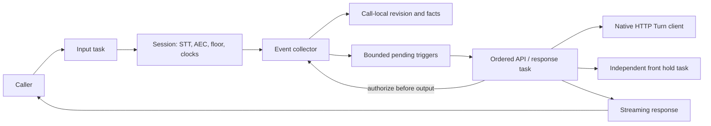

# Call orchestration (module 9)

`Driver::run` owns one call from StartCall through transport shutdown and
EndCall. It composes the existing modules; application reasoning and speculative
model execution remain behind the Python Turn API. The [module-10 host](../service/README.md)
now supplies real HTTP/WebSocket entry points; transfer/recording hooks remain
modules 11/12.

For the implemented entry/exit interfaces, Tokio task graph, eager/final sequence,
clock ownership and shutdown flow, see [the illustrated call-flow guide](CALL_FLOW.md).
For the underlying lifecycle, silence/floor state diagrams, timer arming versus
expiry, and test evidence, see [timer state machines and validation](TIMER_VALIDATION.md).

## Source ownership

| File / type | Role and responsibilities |
|---|---|
| `client.rs` / `TurnApi`, `HttpTurnClient`, `Config` | Typed start/process/end operations, deployment/per-call URL and auth precedence, epoch conversion, stable retry bodies, response limits and deadlines. Create one client per call. Its mutex orders that call's transactions only. |
| `state.rs` / `Inbox`, `Trigger` | Deduplicate callbacks, assign speech revisions, retain ordered triggers and sticky machine verdict. Matching eager/final text retains a revision; changed text or resumption invalidates older output. |
| `port.rs` / `Port`, `Factory`, `Opened` | Independent caller input, speech, clocks, client frames and transport lifecycle interfaces. `SessionFactory` resolves configuration and constructs the real transport after StartCall succeeds. Its settings value is the module-1 `settings` model, not the separate `gateway` host model. |
| `port.rs` / `SessionPort` | Clone the session under a short pointer lock, then release the lock before awaiting I/O. Handles held machine speech, generation checks and final transport cleanup. The closed session retains its writer long enough to send the terminal client frame. |
| `port.rs` / `Hooks`, `NoHooks` | Recording setup, escalation and artifact finalization boundary. `NoHooks` never reports a successful transfer; real implementations belong to modules 11/12. |
| `driver.rs` / `Driver`, `Config`, `Report` | Start the call, own concurrent tasks, apply capacity limits, execute ordered responses, finalize once and return call-local evidence. |
| `driver.rs` / `Shared`, `Context` | Bookkeeping shared **within one call**: facts, revision, counters, source and hold. A fresh `Shared` is allocated inside every `run`; none of these counters is static or shared across calls. |
| `driver.rs` / `Task`, `DeliveryGuard`, `Filler` | Abort owned child tasks on cancellation; publish truncated delivery when speech is cancelled; authorize front output against the latest collected revision. Explicit graceful shutdown also joins the tasks. |

## Execution and speculation

Run on a Tokio multithread runtime to allow independent calls/tasks on multiple
cores. The crate uses the host runtime; it does not create one executor per call.
Caller input and event collection continue during opening speech, HTTP requests,
retry waits, filler speech and TTS. A separate call never takes this call's locks.

When the application path permits speculation, eager requests start it on the
application server. Eager requests normally return an empty acknowledgement.
Engine-hosted calls currently skip eager speculation; retention and transcript
quality gates can also suppress it. The gateway never executes speech, client events,
escalation or end-call actions from an eager response. A matching final is still
submitted once: the application consumes its pinned speculative work. A changed
final/resumed event invalidates gateway output immediately on ingestion, then
reaches the application in transaction order. The collector drains already-queued
events before granting output authorization, including when the response worker
is running on another CPU. Native floor generation checks are an additional guard.

**One committing HTTP transaction per call remains intentional.** Cancelling a
client future does not prove that the server cancelled its transaction. Parallel
same-call mutations would require a versioned server protocol, cancellation
acknowledgement and tool-effect rules. A slow eager acknowledgement can therefore
delay submission of a queued final even though input and invalidation continue.
Suppressing stale gateway output does not roll back application state/tools
already committed by a final request.

## Response and cleanup rules

Facts precede one trigger per request. IDs are `{call_id}-{counter}`, and retries
reuse the exact body. Speech commands are sequential per call. Reasoning pauses
silence clocks, and a normal completed request waits for the current filler to
finish before desk speech. Shutdown aborts and joins filler work instead.

Held `line_quiet` speech deliberately bypasses ordinary stale/floor admission,
waits for the machine greeting and takes the floor with protected/absorb policy,
matching the Python path. Delivery means sent/estimated heard, not proof of
physical audibility. Escalation waits for playback receipts with an eight-second
cap before invoking the hook.

After a valid StartCall, startup failures and hangups still attempt EndCall once
at the driver level. The HTTP client may retry that operation. Shutdown joins
response/input/hold work, closes transport, drains remaining facts, awaits EndCall
independently of caller hangup and then awaits artifact completion with a limit.
Dropping `run` is cancellation, not a substitute for this graceful protocol.

## Deliberate differences and limits

- Python's sequential processor can delay recognizing a newer turn until an
  earlier response completes. Rust collects and invalidates concurrently.
- Replayed positive event sequences and identical timestamped finals are
  deduplicated. A later utterance with the same words remains a new turn.
- Eager acknowledgements cannot directly cause physical or terminal actions,
  even if a faulty service puts such actions in its reply.
- Accepted trigger backlog and total events have explicit limits; overload ends
  the call rather than silently dropping committed triggers. Existing provider
  event channels are still unbounded; this is not complete service backpressure.
- Transport is drained before EndCall on normal and abnormal exits so pending
  delivery facts can be included. Python's normal-exit ordering differs. Normal
  terminal speech first waits for playout receipts (eight-second configurable
  cap), with input still live, so shutdown cannot immediately clear a farewell.
  Resumed speech during that wait revalidates the decision to end the call.
- Empty retry schedules still allow the two-attempt terminal ladder; they do not
  index an absent delay. Artifact hooks are awaited with a timeout.
- Null phone `heard` history is preserved by a documented generator override to
  `Option<HeardHorizon>`; the Python transport emits null despite its annotation.
- Late backwards call-clock ticks are ignored, preventing double-counted elapsed
  time. Normal monotonic traces retain Python parity.
- Clock and receipt events do not notify the speech-revision watcher unless
  the revision actually changes, so unrelated facts cannot terminate a hold.

The existing Python unacknowledged-fact-spool issue remains: after retries exhaust
or an in-flight transaction is cancelled, its facts are not automatically replayed
under a different request ID. Blind replay can duplicate effects after an ambiguous
commit. Synthesized delivery facts also retain Python's `seq=0` behavior; they do
not share the transport's sequence allocator. These need an acknowledged fact
protocol before claiming durable exactly-once delivery. See the two expected
failures in the reference suite.

Recording/upload, actual transfer orchestration, host admission, production
observability (including full latency/first-chunk analytics parity) and live
full-call acceptance are still separate work. No GPT Live tests are run.

See [validation and case matrix](../../validation/orchestration/README.md) and
[performance-critical steps](PERFORMANCE.md).
