# Timer and call-state validation

This audit checks the implemented Rust path, including actual Session wakeups,
the event channel and the driver. It complements the
[timer inventory and timelines](CALL_FLOW.md#timers-deadlines-and-timelines).
No production behavior was changed for the audit. Tests use local fixtures and
mocked application agents; external providers and GPT Live tests remain excluded.

## Which state machine owns the timers?

There is no single `CallState` enum that selects all timers. The implementation
uses cooperating, call-local state machines. This permits listening, reasoning,
playback and time accounting to overlap during a full-duplex call.

| Owner | State and transitions | Timer consequences |
|---|---|---|
| `Driver::run` | Start succeeds, configure/open, active collector, stopping, terminal finalization, returned report. These phases are expressed by control flow and owned tasks rather than an enum. | Session timers exist after Session construction, including during opening speech. Session close aborts its heartbeat/ambience tasks; provider close terminates socket tasks. EndCall/artifact timeouts belong to subsequent finalization. |
| `Engine` | Call-local floor, playback, pending finals, line detector, event sequence and `next_clock_tick`. Inputs and completion callbacks change these states under the Session lock. | Every heartbeat checks floor/line/final deadlines. Only a due approximately one-second gate calls `CallClocks::tick`; some completion callbacks also call Engine tick, using that same gate. |
| `CallClocks` | Armed/unarmed silence; nested pause depth; outstanding playout depth; active ladder and grace; fired-rung sets; pause/playout watchdog anchors. | Silence accrues only when armed, unpaused and no playout is outstanding. Duration thresholds and watchdogs remain eligible while reasoning/playout suppress silence. |
| Floor controller | Caller/agent ownership, episode decisions, classifier flight/draining state, revision, final-wait tokens and protection. | Only active matching work can expire or accept a result. Final timeout invalidates late decisions; timed-out physical requests retain their slot until completion. |
| STT/TTS actors and provider socket | Held legacy final/close deadline; active synthesis/cancellation; outstanding Ping. | Their own async waits handle legacy hold, cancel drain and keepalive. Eager/final provider events are not generated by the heartbeat. |
| Front Source / Hold | Generation, pending/result/deliberate silence, admission history, end notification and owned speech task. | Fallback/follow-up waits apply only while a hold remains eligible. Supersession/end stops waiting; ordinary hold end lets speech already in flight finish. |

The lifecycle below is a description of existing ownership, **not** a proposed
or already-implemented enum:

```mermaid
stateDiagram-v2
    [*] --> Starting
    Starting --> Opening: StartCall succeeds; configure and open Session
    Starting --> Returned: StartCall fails; no Session or EndCall
    Opening --> Active: Session opened; spawn input and opening-response work
    Opening --> Finalizing: Setup fails after successful StartCall
    Active --> TerminalWait: Current response requests end_call
    TerminalWait --> Active: Response becomes stale while waiting
    TerminalWait --> Stopping: Heard or 8 s cap; response still authorized
    TerminalWait --> Stopping: Disconnect or transport failure
    Active --> Stopping: Disconnect, input idle, error or overload
    Stopping --> Closing: Stop input, response and hold work
    Closing --> Finalizing: Interrupt and close Session; drain facts
    Finalizing --> Returned: EndCall, terminal frame and artifact finish attempted
    Returned --> [*]
    note right of Active
        Session heartbeat runs during opening speech and active work.
        Caller input, reasoning and playback can overlap.
    end note
    note right of Closing
        Abort Session timer tasks; close provider tasks.
        This is cooperative cancellation, not an instantaneous barrier.
    end note
    note right of Finalizing
        EndCall outer cap: 90 s.
        Artifact hook cap: 30 s after its own invocation.
    end note
```

The silence eligibility rule is the important state gate:

```text
Each Engine heartbeat:
    check floor / pending final / line deadlines
    if accounting gate is not due: leave CallClocks accounting unchanged
    otherwise:
        emit newly reached duration thresholds
        expire stuck playout / reasoning pause when due
        if sil_armed && playing_depth == 0 && pause_depth == 0:
            accumulate elapsed interval; emit newly reached silence rungs

Caller activity       -> reset silence elapsed, fired silence rungs and grace
Pause / resume        -> increment / decrement this call's pause depth
Playout start / end   -> increment / decrement outstanding playout depth
Final playout release -> allow eligible silence; end policy controls reset
Ladder change         -> preserve idle time, clear that window's fired rungs
Duration rung         -> once per call, independent of silence window resets
```

The floor and provider state machines independently decide whether a timeout
still belongs to current work. Timer arrival does not itself authorize speech or
change the transcript revision.

## State changes that arm and fire timers

**Arming is different from firing.** An input, receipt, response or completion
updates state and may establish a deadline. A later heartbeat or operation timer
checks that the deadline is due and still applicable before changing state or
publishing an event. A result arriving early may remove the need for expiry.

### Silence eligibility and independent duration accounting

The following states summarize combinations of existing `CallClocks` fields.
They are not new enum variants. `Blocked` means silence is armed but either
`pause_depth > 0` or `playing_depth > 0`, including when both are positive.

```mermaid
stateDiagram-v2
    [*] --> Unarmed: CallClocks constructed
    Unarmed --> Eligible: Playout release or watchdog arms silence; both depths zero
    Unarmed --> Blocked: Playout release arms silence; some pause or playout remains
    Eligible --> Blocked: Pause added or playout starts
    Blocked --> Blocked: Partial resume or playout release; another blocker remains
    Blocked --> Eligible: Last blocker released or expires
    Eligible --> Eligible: Accounting tick; accrue idle and emit newly reached rungs
    Eligible --> Eligible: Caller activity resets idle, fired rungs and grace
    Unarmed --> Unarmed: Accounting tick; no silence accrual
    Blocked --> Blocked: Accounting tick; no idle accrual while blocked
    note right of Eligible
        sil_armed and pause_depth == 0 and playing_depth == 0
        Threshold emits once per silence window.
    end note
    note right of Blocked
        Pause watchdog can clear pauses after 30 s.
        Playout watchdog can release stuck playback accounting.
        A remaining blocker still suppresses silence.
    end note
```



Caller activity also resets the silence window in `Unarmed` and `Blocked`; it
does not itself arm silence or remove their blockers. A valid ladder change
preserves accumulated idle time and clears fired silence rungs. Grace changes
thresholds without starting a separate timer. Phone playback receipt/clear
handling feeds these transitions; browser/text do not use that same receipt
lifecycle. Closing stops the host ticker rather than setting a `CallClocks`
closed enum variant.

Duration accounting runs alongside all three silence states:

```text
Engine's approximately one-second accounting gate is due
  |
  +-- elapsed = now - this CallClocks instance's start_t
  +-- for each reached duration rung not already fired:
  |       mark fired --> emit duration_threshold
  +-- expire pause/playout watchdogs if applicable
  +-- evaluate silence eligibility and reached silence rungs

Reasoning, playback and caller activity do not reset duration fired-rung state.
Duration expiry queues a trigger; the application response decides whether to end.
```

### Classifier and final-wait state

Classifier timeout is a logical decision deadline. A timed-out HTTP request may
still be physically in flight. The controller retains its occupied slot to avoid
overlapping physical requests and rejects a late result's authority.

```mermaid
stateDiagram-v2
    [*] --> Idle
    Idle --> Queued: Ambiguous eligible transcript schedules classification
    Queued --> InFlight: Dispatch token and revision; deadline = now + 700 ms
    InFlight --> Idle: Matching completion; apply only if still current
    InFlight --> Draining: Heartbeat observes due classifier deadline
    Draining --> Idle: Physical completion; reject late verdict and free slot
    Queued --> Closed: Controller closes
    InFlight --> Closed: Controller closes
    Draining --> Closed: Controller closes
    Idle --> Closed: Controller closes
    Closed --> [*]
```



An uncertain final can create a separate wait bound to its original worker:

```mermaid
stateDiagram-v2
    [*] --> Waiting: Final needs arbitration; save token and deadline
    Waiting --> Resolved: Original worker finishes before deadline
    Waiting --> Resolved: Heartbeat observes final deadline; invalidate late authority
    Resolved --> Published: Engine reevaluates absorb policy and emits final or absorbed event
    Published --> Published: Re-poll consumed wait does not republish
```



After a worker frees its slot, queued current work can be dispatched in a later
controller step. Closing the Session stops the host continuation path; the
final-wait diagram above describes resolution while that path is still active.

The default final-wait budget is also 700 ms, anchored at wait creation rather
than classifier dispatch. These deadlines can overlap. Supersession, protection,
generation and caller-floor checks remain necessary even before a timeout.
When final is seen while the caller owns the floor, the heartbeat releases that
floor only after 500 ms since the last caller speech. New speech moves that
silence anchor; expiry is not measured from the final event alone.

### Transition-to-timer mapping

All values below are defaults; the full configuration inventory is in
[CALL_FLOW.md](CALL_FLOW.md#timers-deadlines-and-timelines).

| State change / event | What becomes armed or changes | What actually fires, and where |
|---|---|---|
| Session successfully constructed | One 50 ms heartbeat, plus optional 20 ms phone ambience interval | Tokio wakes each task; heartbeat checks Engine state, ambience produces output. Neither tick automatically produces an application event. |
| Provider socket opens | Its 20 s keepalive interval | Socket task sends Ping; next tick fails if Pong remains outstanding. Pong clears that pending state. |
| Reasoning begins for an eager/final caller trigger | Increment silence pause depth; first observing accounting tick anchors pause watchdog | Silence stops accruing. Accounting checks 30 s pause expiry while duration keeps progressing. |
| Reasoning request finishes | Resume one silence pause | Silence becomes eligible only if armed and no other pause/playout remains. Ordinary hold end may still await filler speech. |
| Phone playout begins | Increment playout depth; first observing accounting tick anchors watchdog | Known audio length +10 s, otherwise 90 s, can release stuck accounting. This is not a TTS synthesis timeout. |
| Phone terminal receipt / successful active clear | Release playout depth, arm silence, apply reset policy | Later accounting tick accrues eligible silence; a rung emits `silence_threshold` once per window. |
| Caller activity | Reset silence elapsed, grace and fired silence rungs | No immediate threshold event; eligible idle must accumulate again. Duration rungs remain fired. |
| Eager EOT arrives | Revision handling and queued eager request; optional Source priming | Provider event, not timer expiry. Python application may start speculation. Eager alone does not start the driver's final-response filler hold. |
| Current ordinary final begins processing | Optional Hold starts; API attempt deadline applies when request is dispatched | Pending-model fallback at 900 ms or empty-result fallback at 1500 ms; ready text may return sooner. API attempt defaults to 40 s. |
| New words / resumed speech supersede work | Change revision; invalidate old output and cancel/supersede eligible front work | Old timer completion cannot authorize stale speech; the HTTP transaction remains ordered. |
| Semantic classifier dispatched / final wait created | Separate token-bound 700 ms deadlines | Heartbeat applies due timeout/final continuation; late classifier authority is rejected. |
| TTS cancellation sends Clear | Active output cancelled; 300 ms drain deadline armed after send | TTS actor accepts Cleared or closes the socket on expiry, preventing reuse with stale audio. |
| Application response asks to end | Terminal heard-playout wait, default cap 8 s | Poll every 50 ms; recheck response authority before stopping. Input remains live during the wait. |
| Driver enters finalization | EndCall outer cap 90 s; artifact hook cap 30 s at its later invocation | Each timeout returns to finalization control flow; neither is a recurring call heartbeat. |

Sources: [driver lifecycle and reasoning](src/driver.rs),
[Session task creation/dispatch/close](../transport/src/session.rs),
[Engine tick and publication](../transport/src/engine.rs),
[CallClocks state transitions](../clocks/src/call.rs),
[floor arbitration](../barge-in/src/floor.rs),
[Hold](../front/src/hold.rs), [provider actors](../speech-providers/src/client.rs),
[socket keepalive](../speech-providers/src/wire.rs).

## Evidence by test layer

The audit added **14 tests** to cover gaps between pure state tests and actual
timer wiring. The combined runner also now includes the existing five barge-in
lifecycle tests, which were previously outside that gate.

| Layer | Assertions | Evidence |
|---|---|---|
| Pure clock transitions: 7 added tests | Unarmed versus armed silence; duration during pauses; nested pauses and overlapping playout; activity reset; ladder/grace boundaries; 30 s pause watchdog; known/unknown/overlapping playout deadlines; delayed/duplicate/backwards ticks. | [transitions.rs](../clocks/tests/transitions.rs) |
| Real Session heartbeat: 2 added tests | No incoming traffic or manual `tick`; accounting cannot fire before its gate; actual threshold events arrive once with call-local sequence; silence stays unarmed; shared read-only Clock origins do not share pause state; closing one Session freezes its accounting while its peer continues. | [heartbeat.rs](../transport/tests/heartbeat.rs) |
| Real phone heartbeat: 2 added tests | Playback receipt arms silence; two reasoning pauses suppress it until both resume while duration still fires. Separately, a pending final expires without another transcript/completion; a late classifier cannot cut audio or duplicate final publication. | `heartbeat_*` in [integration.rs](../transport/tests/integration.rs) |
| Real Session through Driver: 1 added test | Heartbeat -> Engine -> event channel -> Inbox -> API request. A second duration event is timestamped while the first API request is blocked, waits its turn, then ends the call exactly once. No synthetic threshold event is injected. | `real_heartbeat_*` in [session.rs](tests/session.rs) |
| Real provider socket interval: 2 added tests | Outgoing Ping; no premature next expiry; Pong permits next scheduled Ping; missing Pong fails and closes at the next interval. | [keepalive.rs](../speech-providers/tests/keepalive.rs) |
| Existing isolation | 16 call traces versus isolated execution; read-only parallel clock access; competing tick producers; independent event sequences and watchdog state. | [clock isolation](../clocks/tests/isolation.rs), [transport isolation](../transport/tests/clock_isolation.rs) |
| Existing floor/line lifecycle | Classifier timeout retains physical slot; final tokens bind original worker; close rejects late completions; line retirement extension and quiet/cap/release conditions. | [floor lifecycle](../barge-in/tests/lifecycle.rs), [line tests](../front/tests/line.rs) |
| Existing async deadlines | Legacy STT final hold fires without another message; TTS cancel expiry requires reconnect; filler pending/empty deadlines and cancellation; HTTP retries/timeouts; terminal/artifact bounds. | [provider sockets](../speech-providers/tests/socket.rs), [front lifecycle](../front/tests/lifecycle.rs), [front clients](../front/tests/clients.rs), [driver lifecycle](tests/lifecycle.rs) |
| Python differential oracle | 100 deterministic randomized clock traces, 15,100 state/event snapshots, plus browser/phone callback and framing comparisons. | [parity runner](../../validation/transport/parity.py), [parity result](../../validation/transport/results/parity.json) |

Real Session tests use real elapsed time because `Clock` reads
`std::time::Instant`. The keepalive-only tests use paused Tokio time: the socket
interval uses Tokio time and does not depend on `Clock`. A runnable guard prevents
automatic virtual-time jumps while loopback I/O settles; a real-time watchdog
bounds fixture waits. The test accounts for Tokio's millisecond deadline rounding.

Reproduce the combined gate and repeat the seven async timer tests:

```sh
data-plane/.venv/bin/python vogon-rust/validation/orchestration/run.py --sockets --reference --checks
data-plane/.venv/bin/python vogon-rust/validation/orchestration/stress.py --timers --repeat 10
```

The [combined manifest](../../validation/orchestration/results/manifest.json)
records counts and source hashes. The
[timer stress manifest](../../validation/orchestration/results/timer-stress.json)
records repeated executions separately. A failed invocation marks its result
unsuccessful before running; earlier successful evidence is not silently reused.

The combined audit run passed **133 native tests**, plus **34 Python reference
tests with two pre-existing expected failures**. The seven async timer-path tests
also passed **10 repetitions / 70 executions**. Formatting, the runner's scoped
Clippy checks and Rustdoc passed. A separate strict Clippy check of the new
heartbeat/keepalive test targets also passed.

Expanding strict Clippy to *all* transport/provider targets exposed five existing
lint findings outside the new timer tests: a large handshake error in the socket
fixture, a collapsible condition in Engine, two unnecessary `vec!` allocations
in the output fixture, and a needless borrow in LiveClient. These are recorded in
[the expanded check log](../../validation/orchestration/results/timer-expanded-clippy.log);
that broader check did not pass and was not suppressed or counted as successful.

## What this establishes, and what remains limited

The state gates and heartbeat-to-event-to-driver path are exercised at separate
layers. They support retaining the heartbeat design. They do not prove every
possible schedule or real-time latency under production load.

* Heartbeat eligibility checks target 50 ms; call accounting targets one second.
  Timing is quantized: state changes between accounting ticks are not prorated
  into exact subsecond silence intervals. Watchdog anchors start on the first
  accounting tick observing their state, as in the Python implementation.
* The heartbeat awaits `dispatch()` after releasing the state lock. Dispatch can
  await output/cancellation I/O; there is no tested hard 50 ms bound under slow
  sinks or runtime saturation. Missed ticks are skipped, elapsed accounting is
  applied on the next eligible tick, and deadline effects can therefore be late.
* The Session timer tasks are aborted on close, not all explicitly joined.
  Cancellation is cooperative; the isolation test observes quiescence after a
  scheduler turn. This does not establish an instantaneous cross-thread shutdown
  barrier at the exact return of `close()`.
* Thresholds produce ordered application triggers. A duration event can be
  collected while HTTP is blocked, but cannot launch a concurrent same-call
  mutation or immediately terminate it by itself.
* Phone playout receipts drive silence arming; browser/text adapters do not share
  that phone receipt lifecycle. Tests do not assume all modes enter identical
  silence states.
* Ambience cadence/output remains covered by transport/audio integration, not a
  dedicated missed-tick/cadence stress assertion. No claim of an exhaustive timer
  or production capacity proof is made.
* The existing lack of a TTS first-audio/total-synthesis deadline remains. Neither
  a healthy Ping/Pong exchange nor expiry of playout accounting bounds a stalled
  synthesis await.
